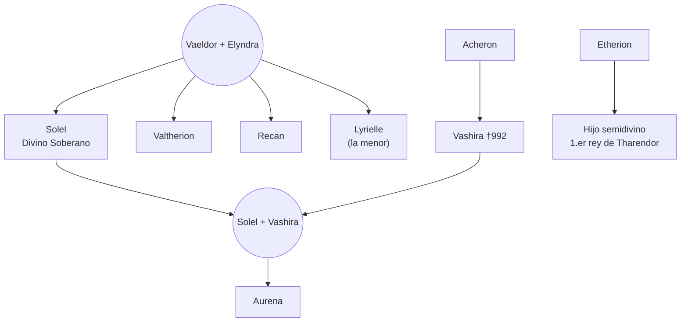

Los cultos del panteón están unidos a la autoridad de la dinastía. Bajo [[Solel]] y las demás divinidades, los templos se encargan de gran parte de la administración ordinaria del imperio, de modo que religión y gobierno van de la mano. Los grandes templos están en el [[Distrito Divino]] de [[Vaelion]].

## Las siete divinidades activas

| Divinidad | Dominios | Templo en Vaelion |
|---|---|---|
| [[Elyndra]] | Vida, naturaleza, fertilidad | Jardines de la Madre Viva |
| [[Solel]] | Sol, justicia, orden | Gran Templo del Sol Justo |
| [[Valtherion]] | Guerra, valor, protección | Bastión de la Lanza |
| [[Recan]] | Creación, ingeniería, arquitectura | Templo de los Arcos Perfectos |
| [[Etherion]] | Magia, conocimiento arcano | Observatorio del Velo Arcano |
| [[Aurena]] | Luz, esperanza, renovación | Basílica de la Primera Luz |
| [[Lyrielle]] | Artes, música, belleza, inspiración | Templo de las Mil Voces |

## Figuras fuera del panteón activo

- [[Vaeldor]], Divino Emperador y Gran Unificador, fundador del imperio, en suspensión divina desde 996.
- [[Vashira]], diosa del descanso eterno y del tránsito de las almas, muerta en 992. Su culto está casi silenciado.
- [[Acheron]], antiguo señor del Inframundo y uno de los Dioses Fundadores, destruido antes de la era imperial.

## Árbol de la familia divina

